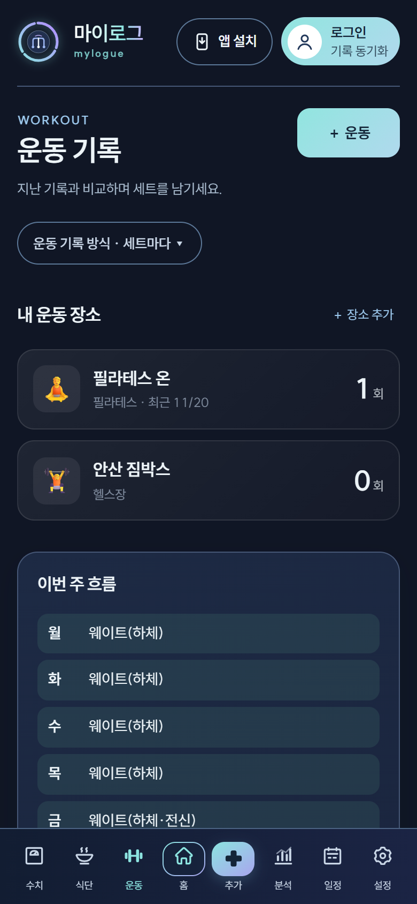
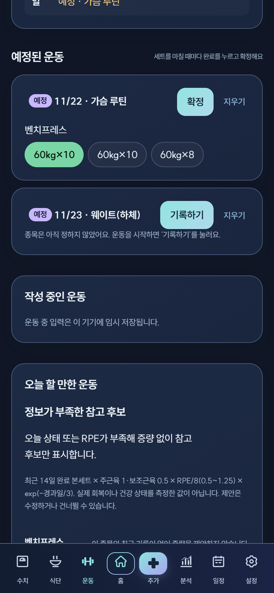
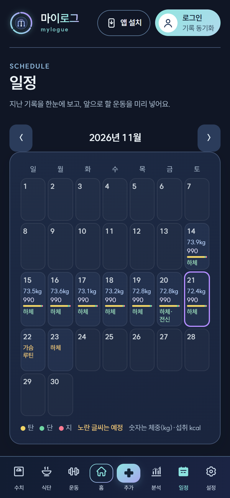
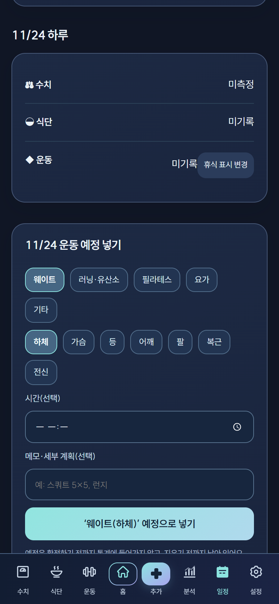
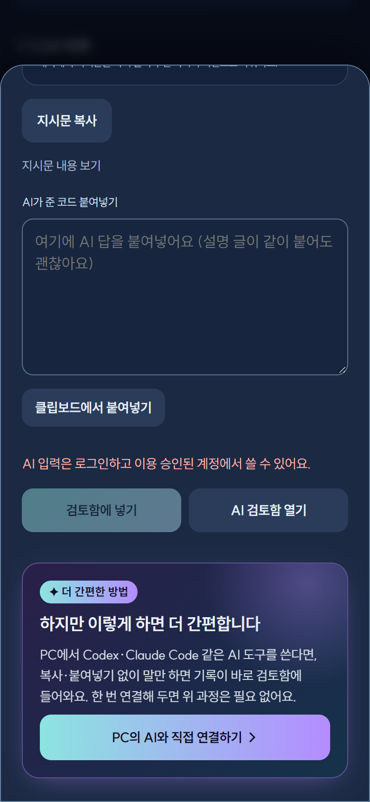
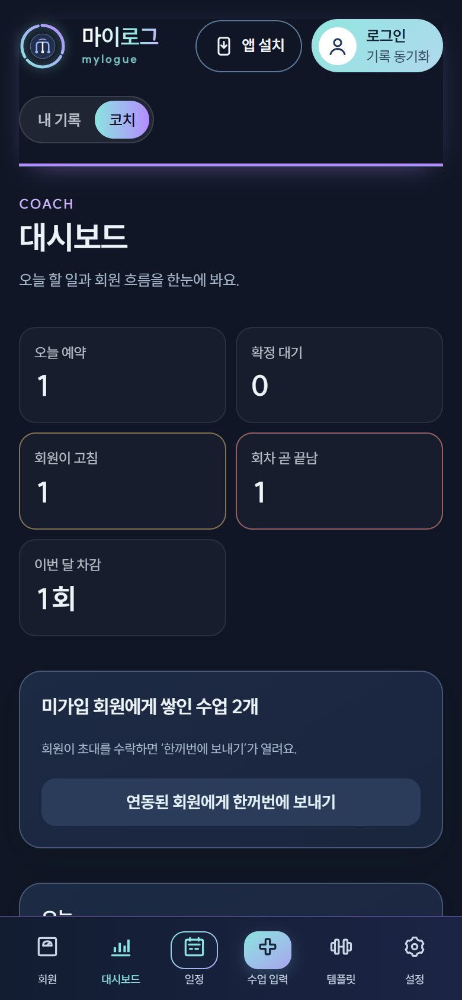
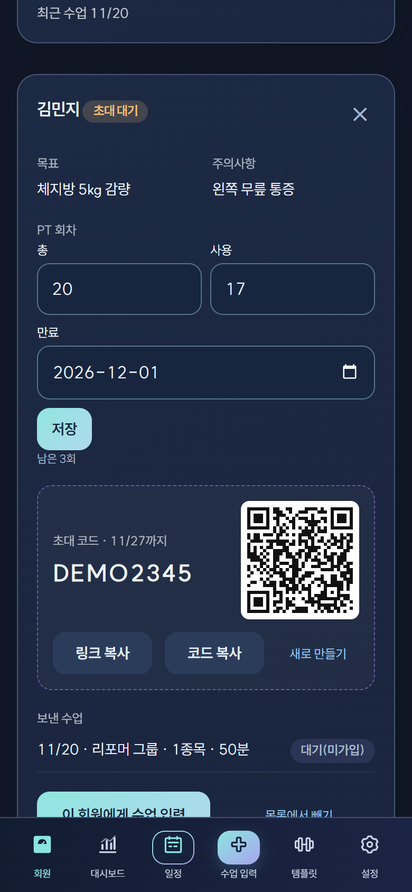
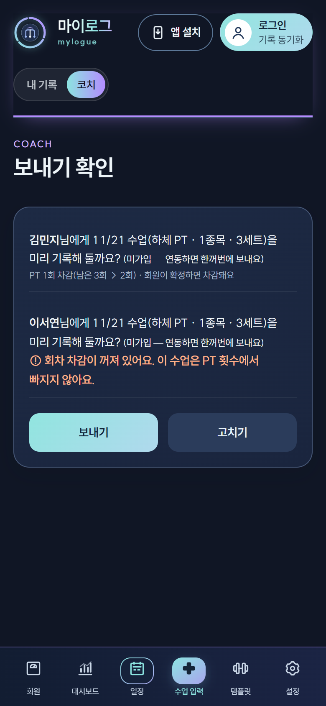
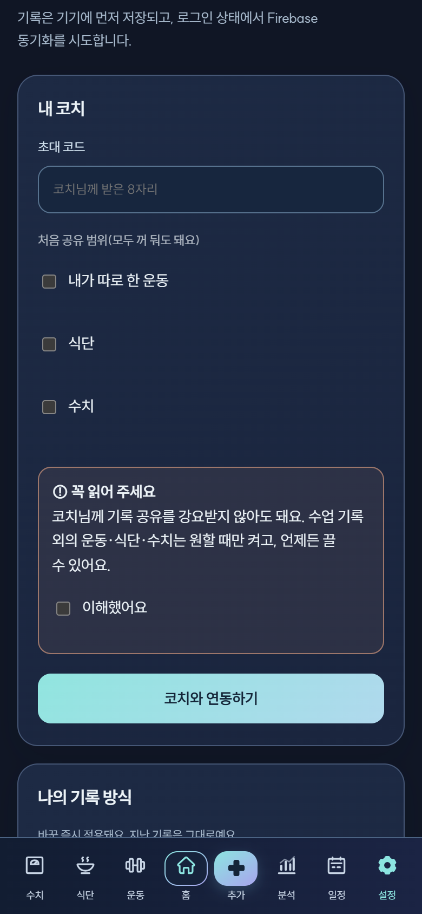

# 마이로그 기능 안내

> 2026-11-22 기준으로 고쳤다(새 기능은 아래 '새로 생긴 것'). 화면 사진은 2026-11-21 촬영본이라 그래프 모양 등 일부가 지금과 다르다(390px 폭, 시험용 데이터). 외부에 보여 주는 문서라 버전 번호는 적지 않는다.
> 화면 원본: [`../business-plan/shots-2026-11-21/`](../business-plan/shots-2026-11-21/)

## 한눈에

| 영역 | 무엇을 하나 |
|---|---|
| 홈 | 오늘의 헤일로(기록 습관 고리)와 '이번 주 n일 기록', 날짜 바, 오늘의 한 줄, 수치·식단·운동 카드, 타임라인 |
| 수치 | 한눈에(일·주·월 체중 흐름, 목표 띠, 주간 변화, 체성분 변화, 식단과 함께, 요일 패턴), 체중·인바디·허리둘레 |
| 식단 | 식단 흐름(점수·칼로리·탄단지 한눈에), 끼니별 기록, 목표 정하기, 이상한 값 정리, GLP-1 사용자 '단백질 먼저' |
| 운동 | 내 운동 장소와 누적 방문, 이번 주 흐름, 예정된 운동(세트별 완료→확정), 부위 균형, 최고 기록, 루틴·일지 |
| 일정 | 달력 칸마다 체중·칼로리와 탄단지 막대·운동, 앞날에 운동 예정 넣기 |
| 추가 | 빠른 기록(수치·식사·운동), AI로 입력 |
| 분석 | 기간별 리포트, AI 인사이트 미리보기 |
| 설정 | 나의 기록 방식, 목표, 운동 장소·머신, 백업·복원, 계정 |

## 새로 생긴 것

### 날짜 바와 '언제' 칸
- 홈·식단·운동 위의 날짜 바로 다른 날을 보고, 그 날짜로 바로 기록한다(화살표·옆으로 밀기·달력).
- 기록 창의 날짜·시각은 '언제' 칸 하나에. 시각 판에서 오전·오후, 시, 10분 단위 분을 누르고 ±5분으로 다듬는다. 자정을 넘기면 날짜도 따라 바뀐다.

### 그래프: 목표 띠
- 모든 그래프가 같은 방식이다. 한 그래프에 한 색, 목표 범위는 옅은 띠, 범위 안은 꽉 찬 점·밖은 빈 점, 오늘은 큰 점. 축 숫자 대신 양 끝 날짜만.
- 그래프에 마우스를 올리거나 손가락으로 누르면 그날 값이 뜬다. 카드 구석 ⓘ로 끌 수 있다.
- 식단 흐름: 위에 식단 점수·칼로리, 아래에 탄수·단백질·지방. 기간은 1주·1달·3달.

### 식단
- 끼니 부르는 법: '식사1·식사2'(하루 여러 번 먹는 사람) 또는 '아침·점심·간식·저녁·야식'(먹은 시각으로). 처음 문답과 설정에서 고른다.
- 자주 먹은 양을 먼저 보여 주고, '어제 이 시각 식사 그대로'를 한 번에 넣는다.
- 1mL에 40kcal처럼 이상한 값은 '정리할 값'으로 모아 보여 주고, 고치면 그 기록만 바뀐다.
- 단위를 바꾸면(210g → 1공기) 영양값은 그대로 두고 단위만 바꾼다.
- 다른 날의 식사를 끼니·시각 그대로 복사한다.
- **GLP-1 계열 약 사용자**: 단백질 목표를 체중 기준(1kg당 1.4~1.6g, 하루 80~120g 안)으로 먼저 정한다. 식단 화면 맨 위에 '단백질 먼저' 막대, 홈 식단 칸에도 단백질이 먼저, 음식 검색에 '고단백' 탭. 근거는 2025년 미국 4개 학회 공동 권고.

### 운동
- 같은 종목의 지난번 세트를 보여 주고, 첫 세트를 지난번 값으로 채운다. '같은 값으로 한 세트 더'는 크게.
- '지난 운동처럼 하기': 최근 운동 2개의 종목을 순서대로 누르기만.
- 운동 기록 중에는 화면이 꺼지지 않는다(지원 기기). 12주 운동 잔디, 주별 흐름, 종목 성장, 새 기록.
- 종목 그림(머신은 머신 모양, 프리웨이트는 사람 자세)을 차례로 넣는 중.

### 헬스장 머신
- 설정 → 내 운동 장소 → '머신 등록'에서 그 헬스장에 있는 머신을 부위별로 한꺼번에 고른다. 머신 종류만 골라도 되고, 펼치면 제조사 모델이 나온다(마이로그에 등록한 헬스장이 많은 순).
- 등록된 머신은 그 헬스장을 쓰는 모든 사람의 운동 기록 맨 위에 '이 헬스장'으로 보인다. 지도에서 찾은 헬스장은 이름을 조금 다르게 적어도 같은 곳으로 맞춘다.
- 일반 사용자는 등록 요청으로 보내고, 운영진이 확인해 한 번에 반영한다.

### 수치
- 체중 한 손 입력: 지난번 체중에서 시작해 큰 ±0.1·±1 버튼으로 맞춘다.
- 리마인드는 체중(3일)·인바디(2주)만. 식단·운동은 알리지 않는다.

### 기록하고 싶게
- 홈 '한눈에 보기' 아래 오늘의 한 줄: 앱을 열 때마다 바뀌고 시간대에 맞는 말이 섞인다. 연구가 근거인 문장은 ⓘ로 출처를 본다.
- 기록 직후 한마디("남겼어요. 이번 주 3일째 기록이에요."), 빈 날에는 탓하지 않는 안내와 바로 기록하는 버튼.
- 헤일로 옆 '이번 주 n일 기록' — 하루 빠져도 끊기지 않는다.

### 편하게
- 지우거나 고친 뒤 '되돌리기'. 지운 기록은 설정의 휴지통에 30일 보관하고 되살릴 수 있다.
- 안드로이드: 앱 아이콘을 길게 누르면 체중·식사·운동 기록 바로가기. 갤러리에서 '공유 → 마이로그'로 인바디 결과지 사진을 바로 읽는다. 웹 앱(설치형)에도 같은 바로가기.
- 저장한 뒤에도 보던 화면에 그대로 머문다.

## 운동

- **내 운동 장소**: 헬스장·필라테스·요가·크로스핏·클라이밍·기타 중 종류를 골라 등록한다. 장소마다 **운동한 날 수**를 세어 '누적 방문'으로 보여 주고, 최근 방문일을 함께 적는다. 예정·휴식은 세지 않는다.
- **이번 주 흐름**: 월~일 한 줄씩. 한 운동은 '하체·가슴', '필라테스'처럼 짧게, 휴식과 예정은 따로 표시한다.
- **예정된 운동**: 세트마다 '완료'를 눌러 가며 운동하고, 끝나면 **확정**한다. 하나라도 완료를 눌렀다면 누르지 않은 세트는 '하지 않은 세트'로 저장되어 볼륨에서 빠진다. 종목을 정하지 않은 예정(예: 웨이트(하체))은 **기록하기**로 빠른 운동 입력을 연다.
- **오늘 할 만한 운동**, **이번 주 부위 균형**(부위별 세트), **종목·머신별 최고 기록**, 루틴·운동 일지.

## 일정

- 달력 하루 칸에 세 줄: **체중**, **먹은 칼로리 + 탄단지 색 얇은 막대**, **한 운동**(노란 글씨는 예정).
- 날짜를 누르면 그날 요약(수치·식단·운동)과 휴식 표시를 바꿀 수 있다.
- 오늘이나 앞날을 고르면 **운동 예정 넣기**: 종류(웨이트·러닝·필라테스·요가·기타)와 웨이트 부위, 시간·메모(선택).
- 예정은 확정 전까지 통계·헤일로에 들어가지 않고, **지우기 전까지 남는다**.

## 날짜·시각 빠르게 고르기

- 기록 창의 날짜·시각은 기본으로 **지금**이다.
- 칸 아래 버튼: 어제·오늘·내일 / 지금 · 가까운 정시(예: 17:16 → 17:00) · −1시간·−30분·−15분·+15분·+30분·+1시간. 달력으로 직접 고르는 것도 그대로 된다.
- **앞으로의 시각**으로 넣은 기록은 입력 방법(직접·AI·붙여넣기·수정)과 관계없이 **예정**이 된다.

## 식단 목표

- 목표 칼로리와 탄수·단백질·지방을 영양소마다 다른 방식으로 정한다: 비율 %, 체중 × g, 고정 g, 나머지. 체중 대비 값은 체중을 새로 기록하면 다시 계산된다.
- 하루 막대는 목표선 기준. 한 영양소가 목표를 넘으면 **넘친 줄만** 길어지고, 크게 넘치면 은은하게 깜빡여 알린다.

## AI로 입력

1. **휴대폰**: '지시문 복사' → 평소 쓰는 AI 대화창에 한 번 붙여넣기 → 말하듯 쓰기 → AI가 준 코드를 붙여넣기 → 검토함에서 확정.
2. **PC**: Codex·Claude Code 같은 AI 도구와 한 번 연결해 두면, 붙여넣기 없이 말만 해도 기록이 검토함으로 들어온다. 창 맨 아래 '더 간편한 방법' 카드에서 연결한다.
3. 지시문에는 최근 기록한 음식·운동 목록이 함께 들어가 AI가 같은 이름과 값을 다시 쓴다.

## 코치 모드 (운영진 시험 중)

> 지금은 운영진 계정에서만 보인다. 다른 계정에는 메뉴·버튼이 나타나지 않는다.

| 강사 | 회원 |
|---|---|
| 헤더 '내 기록 \| 코치'로 전환, 보라색 밑줄 | 설정 '내 코치'에서 초대 코드 입력(링크·QR로도) |
| 회원: 앱 회원 초대(코드·링크·QR, 7일·1회), 미가입 회원 먼저 기록 | 공유 범위(따로 한 운동·식단·수치)는 모두 꺼진 채 시작, 언제든 켜고 끔 |
| 수업 입력: 대상(한 명·그룹), 템플릿·지난 수업 불러오기, 근력·시간 종목, 코멘트, PT 차감 | 코치 수업은 검토함에 '코치 ○○' 배지로 도착, 코멘트와 PT 차감 안내 |
| 보내기 확인: 차감이 꺼지면 경고 | 차감이 꺼진 수업은 받을 때 경고 |
| 대시보드: 오늘 예약·확정 대기·회원이 고침·회차 곧 끝남·이번 달 차감, 회원별 흐름 | 그대로·고쳐서 확정·버리기 → 강사에게 회신 |
| 일정: 주간 예약, 매주 반복, 예약에서 바로 수업 입력 | 내 일정에 코치 예약 표시 |
| 템플릿·그룹, 알림 설정(앱 안 알림), 회원 10명까지 무료 표시 | 연동 끊기 |

개인정보 원칙: 강사는 자기가 보낸 수업과 그 회신만 본다. 회원 기록 원본은 읽지 않으며, 회원이 켠 항목의 요약(최근 7일 운동 수·최근 체중·식단 기록 일수)만 받는다. 공유를 끄거나 연동을 끊으면 바로 막힌다.

## 설치

- Android: 웹 위쪽 '앱 설치' → APK 내려받기. 새 버전을 덮어 설치해도 기록 유지.
- iPhone·iPad: Safari 공유 → 홈 화면에 추가.
